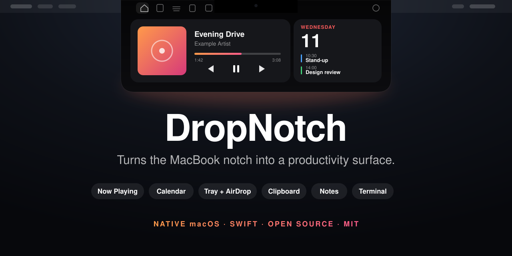
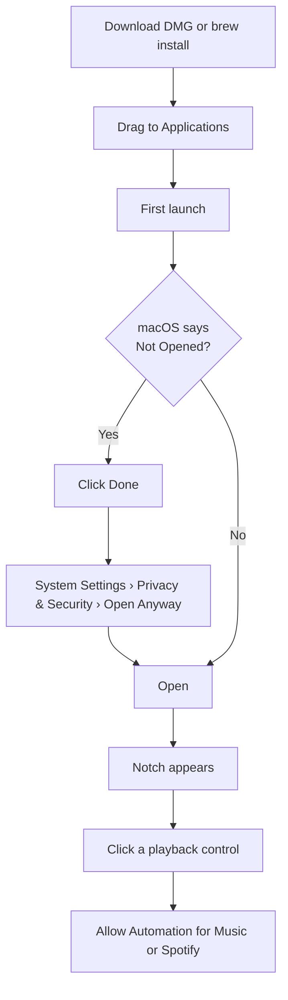
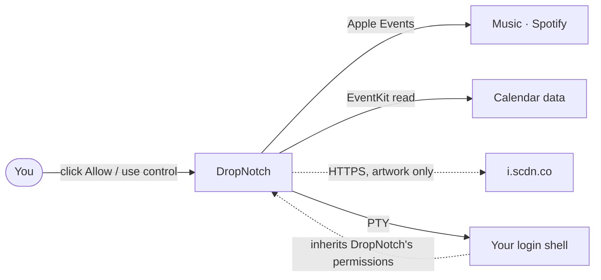
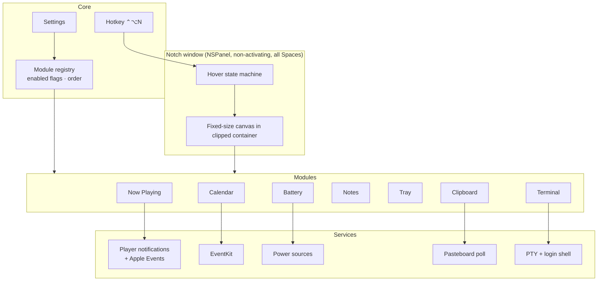
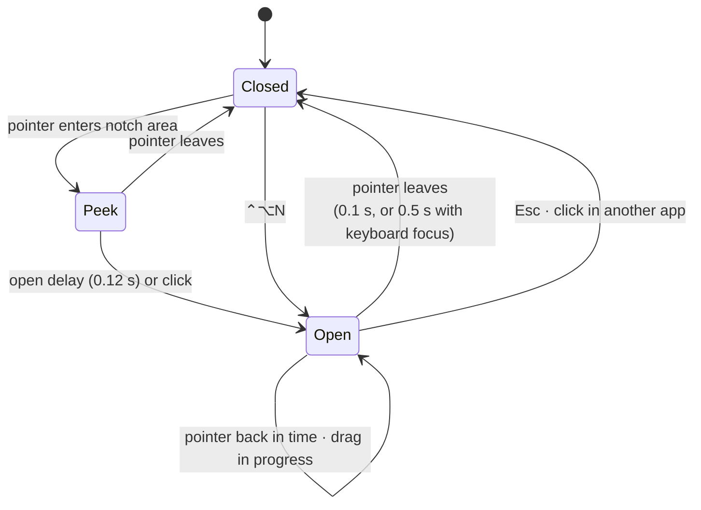
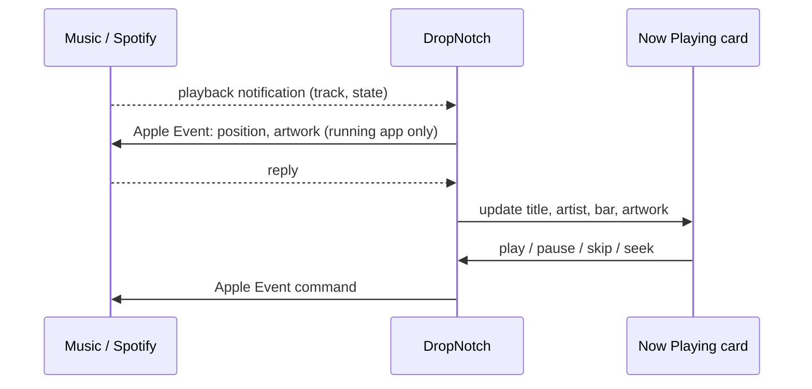
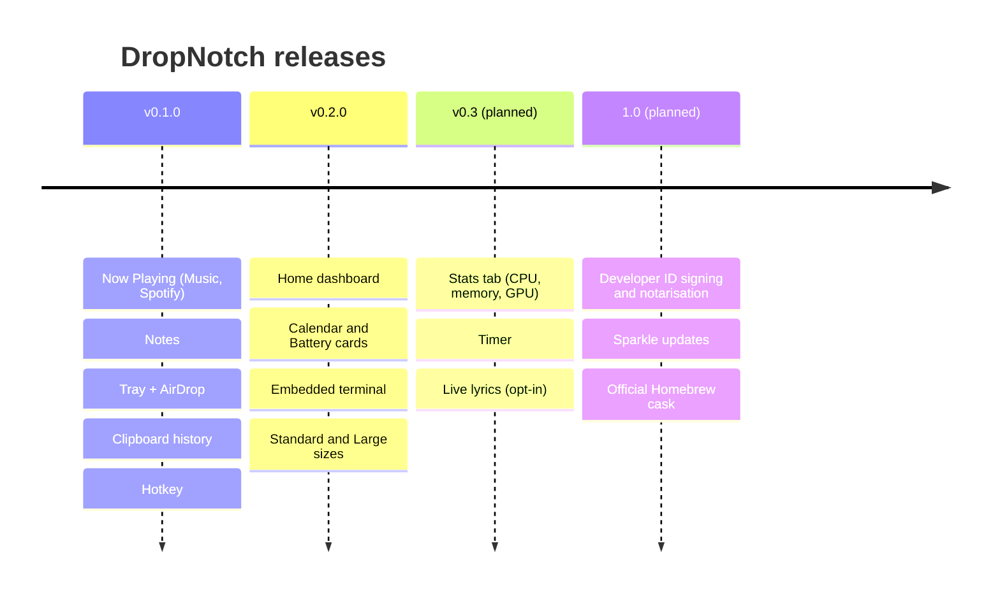

<div align="center">



# DropNotch

**Turns the MacBook notch into a productivity surface.**

Music, calendar, files, clipboard, notes and a terminal, one hover away.

[](https://github.com/Shashwat-19/DropNotch/releases/latest)
[](https://github.com/Shashwat-19/DropNotch/releases)
[](LICENSE)
[](#requirements)
[](#architecture)
[](https://github.com/Shashwat-19/homebrew-tap)
[](https://github.com/Shashwat-19/DropNotch/stargazers)
[](https://github.com/Shashwat-19/DropNotch/issues)
[](https://github.com/Shashwat-19/DropNotch/commits/main)

[**Download**](https://github.com/Shashwat-19/DropNotch/releases/latest) ·
[Install](#install) ·
[Features](#features) ·
[Privacy](#privacy-and-permissions) ·
[Architecture](#architecture) ·
[Roadmap](#roadmap) ·
[Contributing](#contributing)

</div>

> Not yet notarised. macOS shows a "Not Opened" warning on first launch; the [install steps](#install) take about 30 seconds.

<!-- TODO: add docs/images/home.png (Home tab, Large size) and docs/images/demo.gif (hover, music, terminal). Do not link files that do not exist. -->

---

## Contents

- [Features](#features)
- [Install](#install)
- [Usage](#usage)
- [Privacy and permissions](#privacy-and-permissions)
- [Architecture](#architecture)
- [Requirements](#requirements)
- [Build from source](#build-from-source)
- [Roadmap](#roadmap)
- [Contributing](#contributing)
- [Acknowledgements](#acknowledgements)
- [Licence](#licence)

---

## Features

| Tab | What it does |
|---|---|
| **Home** | Dashboard of cards: Now Playing, Calendar, and an optional Battery ring |
| **Notes** | Quick notes without leaving what you are doing |
| **Tray** | Drop files in, drag them out, send them with AirDrop |
| **Clipboard** | History of recent text, links and images; click to copy back. Off until you turn it on |
| **Terminal** | A real shell inside the notch. Off until you turn it on |

**Everywhere**

- Now Playing for **Music** and **Spotify**: play, pause, skip, seek, artwork, track times
- Calendar card with the next events, read from your calendars (no events are changed)
- Global hotkey **⌃⌥N** opens the notch with the keyboard ready
- **Standard** and **Large** notch sizes (Settings › General)
- Turn modules on or off and reorder them in Settings › Modules
- Full keyboard access and VoiceOver labels

### Notch sizes

| Size | Open notch (five or more tabs) | Artwork | Terminal grid |
|---|---|---|---|
| Standard | 596 × 190 pt | 89 pt | 80 × 11 |
| Large | 676 × 230 pt | 124 pt | 92 × 14 |

With fewer than five tabs on, the notch is 60 pt narrower. Sizes are measured on a MacBook Air with a 208 pt notch.

<!-- TODO: screenshots per tab once docs/images exists. -->

---

## Install

### Homebrew

```bash
brew install --cask shashwat-19/tap/dropnotch
```

This adds the tap and installs in one step. After the tap is added, `brew upgrade` and `brew uninstall --cask dropnotch` work with the short name.

### DMG

1. Download `DropNotch-<version>.dmg` from the [latest release](https://github.com/Shashwat-19/DropNotch/releases/latest).
2. Open it and drag **DropNotch** into **Applications**.
3. Open DropNotch. macOS says **"DropNotch.app" Not Opened**: click **Done**, not Move to Bin.
4. Open **System Settings › Privacy & Security**, scroll to **Security**, click **Open Anyway**, then **Open** when the warning appears.
5. Allow **Automation** for Music or Spotify the first time you use a playback control, and **Calendars** when you turn the Calendar card on.

Verify the download (the `.sha256` file is on the same release page):

```bash
shasum -a 256 -c DropNotch-<version>.dmg.sha256
```



The warning exists because the build is not yet notarised by Apple. A Developer ID build is planned for 1.0.

---

## Usage

| Action | How |
|---|---|
| Open the notch | Hover the notch, or press **⌃⌥N** |
| Close | Move the pointer away, press **Esc**, or click another app |
| Switch tab | Click its icon, or press **⌘1**, **⌘2** and so on |
| Open Settings | The gear in the top row, or **⌘,** |
| Type in the terminal | Click the Terminal tab (keys go to the shell straight away), or open with **⌃⌥N** |

**Closing delays.** After a plain hover the notch closes about 0.1 s after the pointer leaves. If it has keyboard focus (terminal, notes, clipboard search) it waits 0.5 s, so a brief drift does not send your next keystrokes to another app.

**Terminal.** Hovering never starts a shell. The session keeps running when the notch closes. **End Session**, turning the tab off or quitting DropNotch stops it. An optional setting, *Type as soon as the notch opens*, gives an already-running shell your keys on hover.

---

## Privacy and permissions

DropNotch is not sandboxed. It has two entitlements and asks for permissions only when you use the feature that needs them.

| Permission | Used for | When it is asked |
|---|---|---|
| Automation (Apple Events) | Reading and controlling Music and Spotify | First click on a playback control |
| Calendars (full access) | Reading today's events for the Calendar card | When you press **Allow** on the card or turn it on in Settings |
| Files and folders | Keeping a link to files you drop in the Tray | When you drop files |

- **Network:** none while idle. Spotify artwork is fetched over HTTPS from `i.scdn.co` only.
- **No analytics, no accounts, no telemetry.**
- **Clipboard history** is off until you turn it on. Concealed types such as password-manager entries are skipped.
- **Calendar:** the card never adds, changes or deletes events. Event titles can be hidden (Settings › Privacy › Show event titles). Titles are never logged.
- **Terminal runs with DropNotch's permissions.** Commands you run there, and your shell's setup files, can use everything DropNotch is allowed to use, without asking again, as in the terminals of VS Code or iTerm. Jobs started with `nohup` or `disown` keep running after you end the session. Turn the tab off in Settings › Modules to stop all of this.
- Programs inside the terminal cannot read or change your clipboard.



---

## Architecture

DropNotch is a Swift app (SwiftUI inside an AppKit panel). Every feature is a **module** that the registry enables, orders and shows as a tab or a Home card.



### Hover state machine



### Now Playing data flow



Key decisions are recorded in [`docs/DECISIONS.md`](docs/DECISIONS.md); the full design is in [`docs/ARCHITECTURE.md`](docs/ARCHITECTURE.md).

### Project layout

```text
DropNotch/            app source (App, Modules, Notch, Services, Settings, Support)
DropNotchTests/       unit tests
docs/                 ARCHITECTURE, DECISIONS, FEATURE_MATRIX, RISKS, RELEASING, mock-ups
scripts/              make-dmg.sh, app icon and DMG background generators
project.yml           XcodeGen spec (source of truth; the .xcodeproj is generated)
```

---

## Requirements

- macOS 14 (Sonoma) or later
- A MacBook with a notch is the target; other Macs get a compact pill at the top of the screen
- Tested on Apple silicon only. The build is universal, but the Intel slice has not been run

---

## Build from source

You need Xcode, [XcodeGen](https://github.com/yonaskolb/XcodeGen) and Homebrew.

```bash
git clone https://github.com/Shashwat-19/DropNotch.git
cd DropNotch
brew install xcodegen
xcodegen generate
xcodebuild -project DropNotch.xcodeproj -scheme DropNotch -configuration Release \
  -derivedDataPath build/DerivedData -skipPackagePluginValidation build
open build/DerivedData/Build/Products/Release/DropNotch.app
```

Run the tests:

```bash
xcodebuild test -project DropNotch.xcodeproj -scheme DropNotch \
  -destination 'platform=macOS' -skipPackagePluginValidation
```

`-skipPackagePluginValidation` is needed because SwiftTerm runs a build plugin. In Xcode, click **Trust & Enable** once.

Never edit `DropNotch.xcodeproj` by hand; change `project.yml` and run `xcodegen generate`. Debug builds do not use the hardened runtime, so test entitlement changes on a Release build. To make a DMG, see [`docs/RELEASING.md`](docs/RELEASING.md).

---

## Roadmap



| Status | Item |
|---|---|
| Done | Home, Now Playing, Calendar, Battery, Notes, Tray, Clipboard, Terminal, sizes |
| Planned | Stats, Timer, live lyrics |
| Planned | Signed and notarised builds; automatic updates |
| Under evaluation | AirPods and Bluetooth headphone battery (no stable public API found) |

Dates are not promised. Open an issue to vote or suggest.

---

## Contributing

Issues and pull requests are welcome.

1. Open an issue first for anything larger than a bug fix.
2. Branch from `main` (`feat/...` or `fix/...`).
3. Keep changes small, add tests, and make sure `xcodebuild test` passes.
4. Read [`CLAUDE.md`](CLAUDE.md) for the project rules: no private APIs, no new entitlements without a decision entry in `docs/DECISIONS.md`.

**Clean-room rule.** DropNotch is original work. Do not copy code from other notch apps, and do not paste code from projects with an incompatible licence. Features inspired by other apps are written from behaviour descriptions only.

Report security problems privately through GitHub's *Report a vulnerability* button on the Security tab, not in a public issue.

---

## Acknowledgements

- [KeyboardShortcuts](https://github.com/sindresorhus/KeyboardShortcuts) (MIT): global hotkey
- [SwiftTerm](https://github.com/migueldeicaza/SwiftTerm) (MIT): terminal view

Full notices are in [`THIRD_PARTY_NOTICES.md`](THIRD_PARTY_NOTICES.md).

---

## 📚 Documentation

Comprehensive documentation for this project is available on [Hashnode](https://hashnode.com/@Shashwat56).

> At present, this README serves as the primary source of documentation.

## 📜 License

This project is distributed under the MIT License.  
For detailed licensing information, please refer to the [LICENSE](./LICENSE) file included in this repository.

## 📩 Contact  
## Shashwat

**Machine Learning Engineer | Scalable AI Systems**

🔹 **ML systems:** (CV, NLP) + data pipelines<br>
🔹 **End-to-end:** training → deployment<br>
🔹 **Backend & Cloud:** Python, Flask, Node.js, Docker, AWS<br>
🔹 **Projects:** Traffic AI, Video Summarizer, AI Assistants<br>

---

## 🚀 Open Source | Tech Innovation  
Building robust applications and leveraging cloud technologies for high-performance solutions.

---

### 📌 Find me here:  
[](https://github.com/Shashwat-19)  [](https://www.linkedin.com/in/shashwatk1956/)  [](mailto:shashwat1956@gmail.com)  [](https://hashnode.com/@Shashwat56)
[](https://www.hackerrank.com/profile/shashwat1956)

> Feel free to connect for tech collaborations, open-source contributions, or brainstorming innovative solutions!

